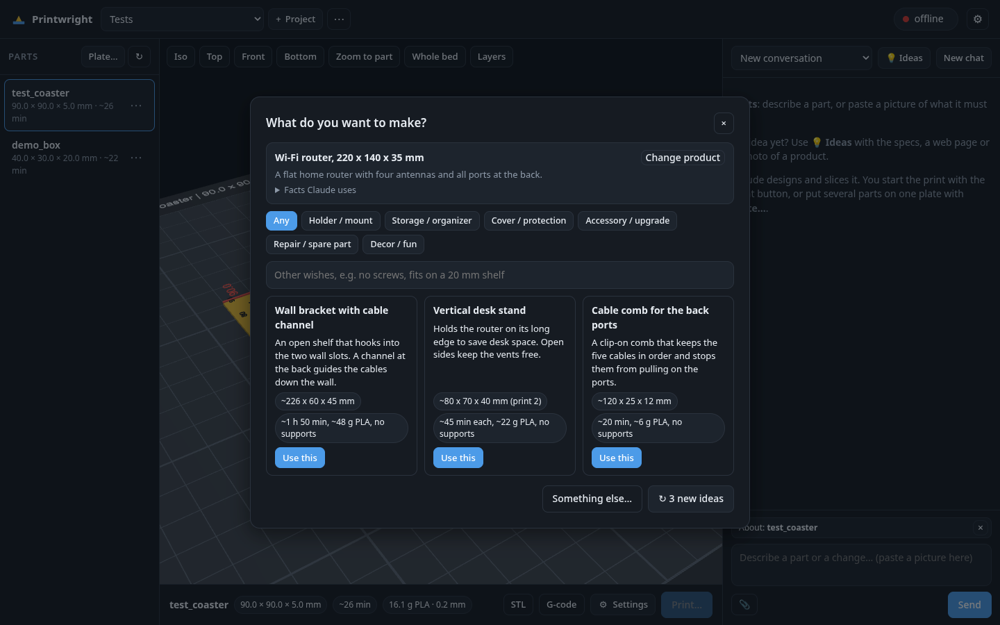
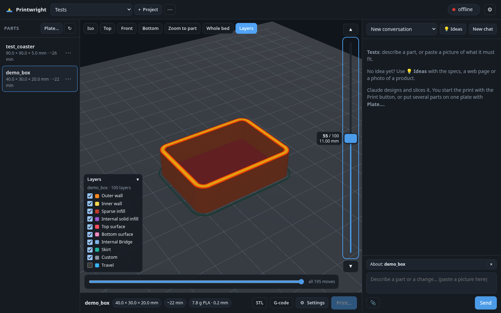
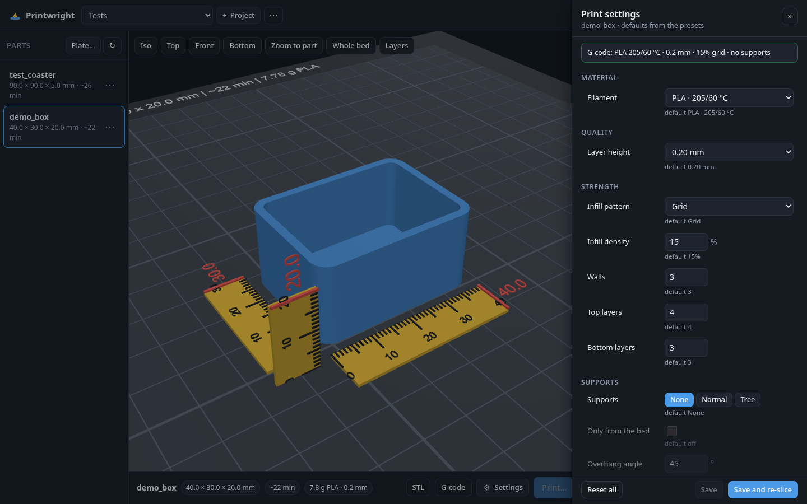
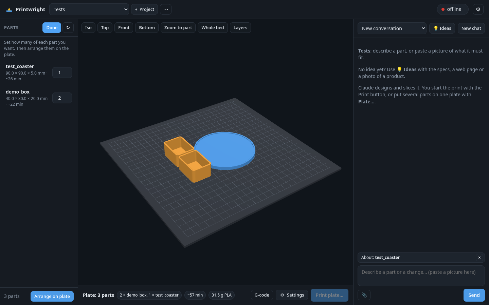

# Printwright features

The README covers the install. This file lists what Printwright can do.

- [Design & ideas](#design--ideas)
- [Viewer](#viewer)
- [Slicing](#slicing)
- [Plates](#plates)
- [Printing](#printing)
- [Projects & files](#projects--files)
- [Manage](#manage)
- [Setup](#setup)

## Design & ideas



- **Design from text.** Describe a part in the chat. Claude Code writes a build123d model in `src/<part>.py`
  through the [text-to-cad](https://github.com/earthtojake/text-to-cad) plugin and its `cadgen` tool.
  All sizes are named constants at the top of the file.
- **Change in words.** Select a part and ask "10 mm taller" or "add a hole". The chat knows which part you mean.
- **Pictures and files.** Paste, drag or attach pictures, PDFs, STL, STEP and other files. Claude reads them.
- **Live replies.** Replies stream into the page. A page reload re-attaches to a running reply. **Stop** ends it.
- **Chat history.** Each project keeps its own chats. Pick an older chat from the list.
- **Ideas.** Give product specs, a link to a product page or a photo. Claude reads them and suggests 3 printable parts.
  - The window shows the product facts that Claude uses (size, ports, holes).
  - Pick a category, add wishes, or ask for 3 new ideas. Shown ideas are not repeated.
  - **Use this** sends a complete design request for the idea to the chat.
  - Ideas run `claude -p` with only WebFetch and WebSearch (and Read for your files), in an empty folder.
- **Design rules for FDM.** The workspace `CLAUDE.md` tells Claude to design flat bases, overhangs up to 45°,
  walls of at least 1.2 mm and clearance for screws.

## Viewer



- **Bed view.** A three.js viewer shows the part on your bed with a 10 mm grid and bed coordinates.
- **Rulers.** X, Y and Z rulers stand beside the part. A red mark shows the exact size.
- **Label.** The bed shows the size, the print time and the grams. The info bar below shows them too.
- **Views.** Iso, Top, Front, Bottom, Zoom to part and Whole bed. From below, the bed turns see-through.
- **Layer view.** **Layers** shows the sliced G-code layer by layer.
  - Lines are coloured by feature type: walls, infill, top and bottom surfaces, bridges, supports, skirt.
  - Drag the layer slider, or use Arrow Up/Down and Page Up/Down. The top layer is bright, the layers below are dim.
  - The lower slider plays the moves of the top layer one by one.
  - Untick a feature type in the legend to hide it. Travel moves are hidden at first.
  - The server parses each G-code once and keeps a cache next to it in `gcode/`.
- **Downloads.** Download the STL or the G-code of a part.
- **Phone layout.** On a small screen, tabs switch between Parts, View and Chat.

## Slicing



- **OrcaSlicer 2.4.2, headless.** It runs from the Flatpak, or from a Docker image built from the official release.
- **One command.** `tools/make.sh <part>` builds the model, slices it, estimates the time and refreshes the bed view.
- **Real print time.** The presets use your printer's Klipper limits (`tools/make_presets.py`).
  A factor learned from your finished prints corrects OrcaSlicer's estimate. The warm-up time is added.
- **Print settings per part.** **Settings** opens a panel with:
  - material (PLA, PETG, TPU) with its temperatures,
  - layer height,
  - infill pattern and density, walls, top and bottom layers,
  - supports (none, normal or tree), "only from the bed" and the overhang angle,
  - brim (none, auto or outer) and brim width,
  - the turn on the bed around X, Y and Z, or "lay flat" by OrcaSlicer.
- **Changed values are marked.** Each value shows its default. **Reset** puts one value back, **Reset all** all of them.
- **Re-slice only.** **Save and re-slice** runs the slicer on the STL as it is. The CAD model does not build again.
- **Stale check.** The panel tells you when the G-code does not use the saved settings yet.
- **Settings file.** The panel writes `presets/parts/<part>.json` in the workspace. You or Claude can also edit it.
  Other OrcaSlicer process keys in the file pass to the slicer as they are.

  ```json
  {"sparse_infill_pattern": "gyroid", "sparse_infill_density": "25%", "wall_loops": "4",
   "enable_support": "1", "support_type": "tree(auto)", "brim_type": "outer_only", "brim_width": "5",
   "material": "PETG", "placement": {"rotate": [0, 0, 90], "auto_orient": false}}
  ```

- **Materials.** PETG (240/80 °C) and TPU (225/50 °C) presets come from OrcaSlicer's Generic profiles
  (`tools/make_filaments.py`).

## Plates



- **Several parts on one bed.** **Plate…** lets you set a count for each part of the project.
- **Arrange.** **Arrange on plate** lets OrcaSlicer place and slice all copies together.
- **Preview.** The viewer shows the arranged plate with the total time and grams before you print.
- **Fit check.** The size turns red and the app tells you when the copies do not fit on one plate.
- **Plate settings.** A plate has its own settings file, `presets/parts/plate_<project>.json`.
  OrcaSlicer cannot mix settings on one plate. Each part keeps its own turn on the bed.
- **Command line.** `tools/plate.py plate_<project> <part>:<count> ...` does the same without the page.

## Printing

- **Printer status.** The top bar shows the state, the temperatures and the progress. **Cancel print** stops a print after a confirm.
- **Live progress.** While a Printwright file prints, the status shows the time left.
  **Follow print** moves the layer view to the layer that prints now.
- **Safe start.** Only the **Print…** button starts a print. The dialog asks you to confirm that the bed is empty
  and that the right filament is loaded. It reads the material from the G-code.
- **Server checks.** The server refuses to print when the printer is busy, or when the G-code is older than the model.
- **The chat cannot print.** The chat agent has a deny list for printing, uploading, cancelling, `curl`, `wget`, `git` and `rm`.
  `tools/printer.py` also refuses these commands when the web app runs it for the chat.
- **File prefix.** Uploaded files start with `file_prefix` (default `AI_`). Other files on the printer stay untouched.
- **Command line.** `tools/printer.py status | upload | print | start | cancel | estimate`.

## Projects & files

- **Projects.** Each project keeps its own parts, chats, ideas, files and plate.
  A new project can start with the Ideas window.
- **Project files.** Pictures and files you add are stored in `projects/<id>/files/`.
- **Workspace.** Your parts and config live in a workspace folder, apart from the app.
  The workspace links `tools` and `src/lib` to the app. Thus the same commands work in every workspace.

  ```
  my-workspace/
    printwright.json        your printer and preferences
    CLAUDE.md               workflow rules for Claude
    .claude/settings.json   enables the text-to-cad plugin
    src/<part>.py           part models (source of truth)
    src/lib -> <app>/lib    bed view library (link)
    tools -> <app>/tools    build, slice, plate, printer tools (link)
    projects/<id>/          project.json and files/
    presets/                optional: your own OrcaSlicer presets
    STEP/ STL/ GLB/ gcode/ tmp/   generated, not in git
    .printwright/           chats and Ideas runs, not in git
  ```

- **Git history.** After each chat reply, the app commits changed parts in the workspace git repo.
  It pushes only when the repo has a remote. `PRINT_WEB_NO_GIT=1` turns this off.

## Manage

- **Part menu (⋯).** Rename a part, move it to another project, restore an older version from git, or delete it.
- **Project menu (⋯).** Rename or delete the project. Its parts can move to "Not in a project".
- **Confirm first.** Every change goes through a confirm dialog and becomes a git commit, for example "Delete part demo_box".
  You can get a deleted part back from the history.
- **No clashes.** These actions wait while Claude works on a reply.
- **Background builds.** After a rename or a restore, the part builds again in the background.

## Setup

- **Setup check.** `tools/check-setup.sh` checks Claude Code, the text-to-cad plugin, uv, OrcaSlicer, Python and git.
  It installs nothing. `deploy/install.sh` stops when something is missing. `tools/init-workspace.sh` only warns.
- **First-run setup screen.** While the example printer URL is in `printwright.json`, the page asks for your name,
  the printer, the Moonraker URL (with a connection test), the bed size, the nozzle and the material.
  The ⚙ button opens these settings again.
- **Workspace init.** `tools/init-workspace.sh [--examples] <dir>` creates or repairs a workspace. It never overwrites your files.
- **Service.** `deploy/install.sh` installs a systemd user service and builds the OrcaSlicer Docker image when no Flatpak exists.

### printwright.json

| Key | Example | What it does |
| --- | --- | --- |
| `owner` | `"Alex"` | Your name. Claude uses it in its prompts. |
| `printer_name` | `"Elegoo Neptune 4 Pro"` | Shown in the page and in prompts. |
| `moonraker_url` | `"http://printer.local"` | Moonraker base URL. `PRINTER_URL` overrides it. |
| `bed` | `[235, 230, 265]` | Usable bed X, Y and height Z in mm. |
| `nozzle` | `0.4` | Nozzle diameter in mm, for prompts. |
| `material` | `"PLA"` | Default material, for prompts and the print dialog. |
| `file_prefix` | `"AI_"` | Prefix of the files Printwright uploads. The time factor learns from these prints. |
| `presets` | `""` | Folder with `printer.json`, `process.json`, `filament-1.json`. Empty means the app's `presets/`. A relative path is relative to the workspace. |
| `orca` | `{"printer": …, "process": …, "filament": …}` | OrcaSlicer profile names for `tools/make_presets.py`. |

### Web app environment

The service reads `~/.config/printwright/env`.

| Variable | Default | What it does |
| --- | --- | --- |
| `PRINTWRIGHT_WORKSPACE` | (required) | The workspace folder. Use an absolute path. |
| `PRINT_WEB_MODEL` | empty | Claude model for the chat and Ideas. |
| `PRINT_WEB_HOST` | `0.0.0.0` | Listen address (service only). |
| `PRINT_WEB_PORT` | `8420` | Listen port (service only). |
| `PRINT_WEB_NO_GIT` | empty | Set to `1` to stop the auto-commit. |

The tools find the workspace from `PRINTWRIGHT_WORKSPACE`, else from the current folder.

### Another printer

The default presets are for an Elegoo Neptune 4 Pro with a 0.4 mm nozzle, PLA and 0.20 mm layers.

1. Set `printer_name`, `moonraker_url`, `bed`, `nozzle` and `material` in `printwright.json`.
2. Find the OrcaSlicer profile names for your printer. The text-to-cad gcode skill has a helper:

   ```bash
   python3 ~/.claude/plugins/cache/earthtojake/text-to-cad/*/skills/gcode/scripts/orca_presets.py --list machine --match "MK4S"
   ```

3. Put the names in `orca` in `printwright.json`.
4. In the workspace, run `tools/make_presets.py`. It writes complete presets into `presets/` with the limits
   from your printer's Klipper config. Use `--offline` when the printer is not reachable.
5. Set `"presets": "presets"` in `printwright.json`.
6. Slice a test part with `tools/make.sh demo_box`. Check the temperatures in the output.
