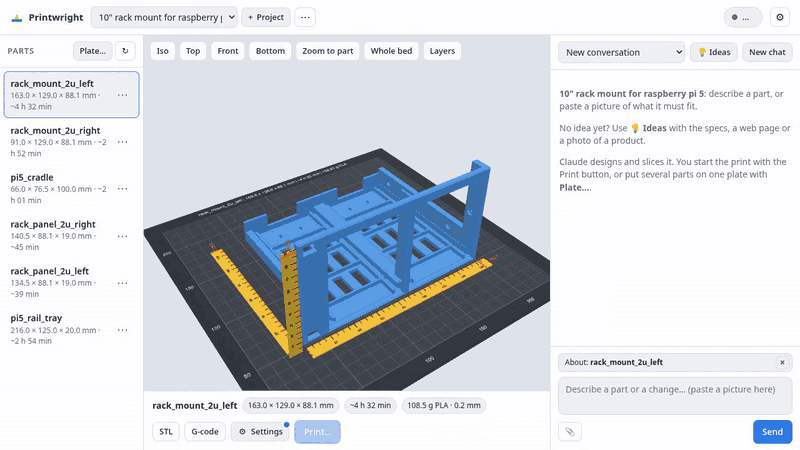

# Printwright

Printwright turns a short description into a printed part. You describe the part in a chat.
[Claude Code](https://claude.com/claude-code) designs a parametric CAD model with the
[text-to-cad plugin](https://github.com/earthtojake/text-to-cad). OrcaSlicer slices it.
A web app shows the part on your printer bed with rulers, the print time and the filament.
When the part looks right, you press Print. The app sends it to your Klipper printer through Moonraker.



See [FEATURES.md](FEATURES.md) for the full feature list.

## Requirements

- Linux.
- [Claude Code](https://claude.com/claude-code), installed and logged in.
- The [text-to-cad](https://github.com/earthtojake/text-to-cad) Claude Code plugin by earthtojake (see Install, step 1).
- [uv](https://docs.astral.sh/uv/). It runs `cadgen` and the web app.
- OrcaSlicer 2.4.2: the Flatpak `com.orcaslicer.OrcaSlicer`, or Docker (the install script builds an image).
- `python3` 3.10 or newer, `git` and `bash`.
- A printer with Klipper and Moonraker on your LAN. You can design and slice without one.

## Install

1. Install the text-to-cad plugin. Printwright does not install it for you:

   ```bash
   claude plugin marketplace add earthtojake/text-to-cad
   claude plugin install text-to-cad@earthtojake
   ```

2. Clone the app and check the setup:

   ```bash
   git clone https://github.com/MundaPlus/printwright.git ~/printwright
   cd ~/printwright
   tools/check-setup.sh
   ```

3. Create a workspace for your parts. `--examples` adds two example parts:

   ```bash
   tools/init-workspace.sh --examples ~/printwright-workspace
   ```

4. Run `deploy/install.sh`. The first run writes `~/.config/printwright/env` and stops.
5. Check `PRINTWRIGHT_WORKSPACE` and the port in `~/.config/printwright/env`.
6. Run `deploy/install.sh` again. It installs and starts the systemd user service `printwright`.
7. Open `http://<this machine>:8420`. On the first start, a setup screen asks for the printer and the bed size.

To run the app without systemd:

```bash
uv sync --project web
PRINTWRIGHT_WORKSPACE=~/printwright-workspace \
  uv run --project web uvicorn app:app --app-dir web --host 127.0.0.1 --port 8420
```

## Usage

- Describe a part in the chat, for example "A wall hook for a 30 mm broom handle, 2 screw holes".
- Claude writes `src/<part>.py` in the workspace, then builds and slices it.
- Check the size, the print time and the grams in the bed view. Ask for changes in words.
- Press **Print…**, confirm that the bed is empty and the filament is loaded, then start the print.

You can also work without the web app. Open Claude Code in the workspace and describe a part.
The workspace `CLAUDE.md` tells Claude the workflow. `tools/make.sh <part>` builds and slices one part.

The workspace keeps your parts, projects and `printwright.json`. The app keeps the code.
Thus you can update the app and keep your parts in a private git repo.
[FEATURES.md](FEATURES.md#setup) lists the settings.

Logs of the service: `journalctl --user -u printwright -f`.

## Security

- **Printwright has no built-in login.** Anyone who can open the page can use it.
- Run it only on a trusted LAN, or behind a reverse proxy that adds authentication and TLS.
- The chat agent edits files in the workspace and runs the build tools on your machine.
- The chat agent cannot print, upload or cancel. A deny list and a check in `tools/printer.py` block it.
- Only the Print button in the page starts a print, after a confirm dialog.
- Moonraker gets no API key from Printwright. Keep the printer on a trusted network.

## License

MIT. See [LICENSE](LICENSE).

## Credits

Made by Munda Plus — https://munda.si

- CAD modelling uses the text-to-cad Claude Code plugin by earthtojake — https://github.com/earthtojake/text-to-cad.
  Its `cadgen` package (MIT, from PyPI) builds the models with [build123d](https://github.com/gumyr/build123d).
  Printwright does not bundle either. You install the plugin from its source, and `uvx` fetches `cadgen`.
- Slicing by [OrcaSlicer](https://github.com/OrcaSlicer/OrcaSlicer) (AGPL-3.0).
  Printwright runs it as an external program and does not bundle it.
  The Docker image in `docker/orcaslicer/` is built from the official OrcaSlicer release.
- The 3D viewer uses [three.js](https://threejs.org) (MIT), vendored in `web/static/vendor/three/`.
- Printer control through [Moonraker](https://github.com/Arksine/moonraker) and [Klipper](https://www.klipper3d.org).
- Chat and Ideas run on [Claude Code](https://claude.com/claude-code) by Anthropic.
